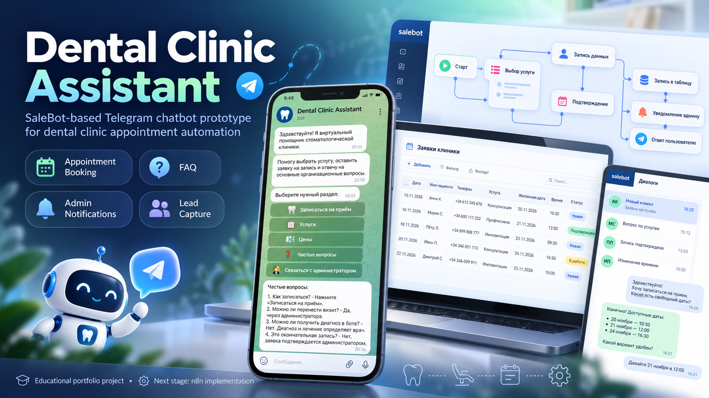
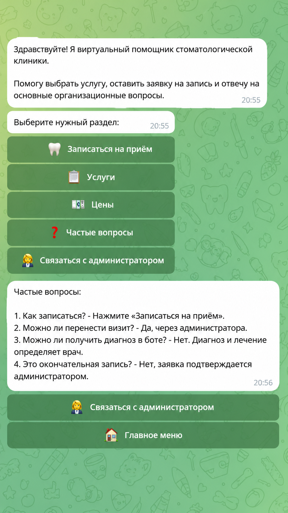
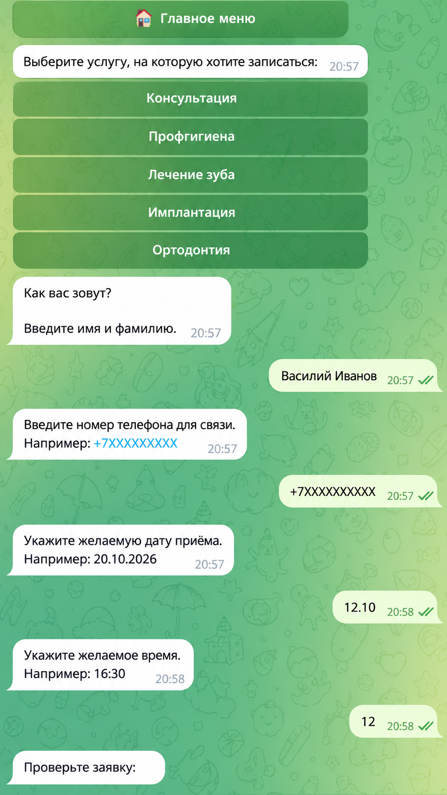
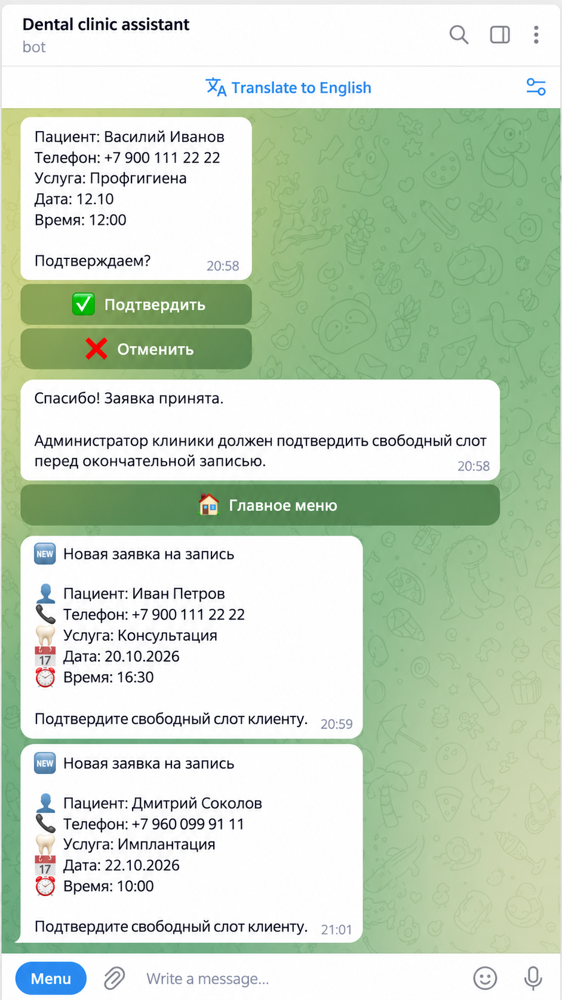
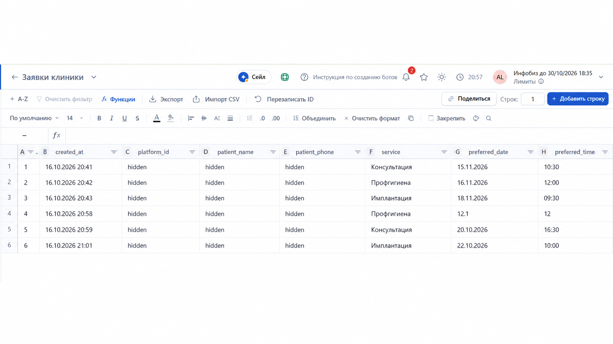
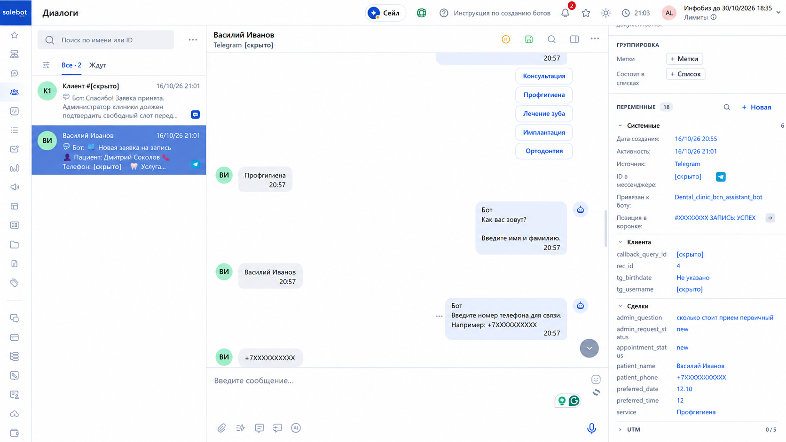

# Dental Clinic Assistant

A SaleBot-based Telegram chatbot prototype for automating patient intake and appointment requests in a dental clinic.

## Overview

The project demonstrates how a dental clinic can automate the first stage of patient communication:

- provide information about services and prices;
- answer common organizational questions;
- collect appointment request data;
- validate the patient's phone number;
- confirm the request before submission;
- store confirmed requests in SaleBot;
- notify an administrator in a separate Telegram account;
- safely handle repeated button clicks and invalid input.

This project was created as an educational prototype for a real business use case and is designed for further development into a production-grade automation system.

## Business Problem

Dental clinics often receive repetitive requests through messengers:

- “How much does a consultation cost?”
- “Can I book an appointment?”
- “What services do you provide?”
- “Can someone contact me?”

When these requests are processed manually, the administrator spends time collecting the same information from every patient and transferring it into internal records.

The goal of this prototype is to automate this routine while keeping the final confirmation of an appointment under administrator control.

## Solution

The chatbot guides the patient through a structured flow:

1. Start the bot.
2. Choose a section from the main menu.
3. Select a dental service.
4. Enter name and phone number.
5. Enter preferred appointment date and time.
6. Review the request.
7. Confirm or cancel.
8. Save the confirmed request in SaleBot.
9. Send the structured request to the administrator in Telegram.

The bot also includes FAQ, service information, prices, and a separate flow for contacting the administrator.

## Architecture

Current architecture:

```text
Patient
  ↓
Telegram Bot
  ↓
SaleBot
  ├── Main menu
  ├── Services / Prices / FAQ
  ├── Appointment request workflow
  ├── Phone validation
  ├── Confirmation / cancellation
  ├── SaleBot table: "Clinic Requests"
  └── Telegram notification to administrator
```

The detailed architecture and workflow diagram is available in:

- [`docs/Dental_Clinic_Assistant_Architecture.pdf`](docs/Dental_Clinic_Assistant_Architecture.pdf)
- [`workflow/Dental_Clinic_Assistant_SaleBot_flow.mmd`](workflow/Dental_Clinic_Assistant_SaleBot_flow.mmd)

## Main Workflow

```text
/start
  ↓
Main Menu
  ↓
Select Service
  ↓
Patient Name
  ↓
Phone Number
  ↓
Phone Validation
  ↓
Preferred Date
  ↓
Preferred Time
  ↓
Review Request
  ↓
Confirm
  ↓
Save to SaleBot Table
  ↓
Notify Administrator in Telegram
```

## Key Features

- Telegram bot connected to SaleBot
- Main navigation menu
- Service selection
- FAQ and price information
- Structured appointment request flow
- Patient name collection
- Phone number validation
- Preferred date and time collection
- Request confirmation and cancellation
- Persistent request storage in SaleBot
- Request status: `new`
- Automatic Telegram notification to administrator
- Separate administrator-question flow
- Protection against repeated service-button clicks during free-text input
- Return-to-menu navigation

## Data Model

Confirmed appointment requests contain:

| Field | Purpose |
|---|---|
| `created_at` | Request creation time |
| `platform_id` | Telegram/SaleBot user identifier |
| `patient_name` | Patient name |
| `patient_phone` | Contact phone |
| `service` | Selected dental service |
| `preferred_date` | Preferred appointment date |
| `preferred_time` | Preferred appointment time |
| `status` | Request status (`new`) |

## Reliability and Input Handling

A separate interception flow protects the appointment process from repeated button clicks.

For example, if the user presses a service button again while the bot is waiting for a name, date, or time, the button label is not saved as user data. The chatbot redirects the user back to the service-selection step.

Phone input is validated before the workflow continues.

## Testing

Five end-to-end scenarios were tested:

1. Main menu, informational branches, and navigation.
2. Service selection and patient data collection.
3. Phone validation and invalid-input recovery.
4. Request confirmation, persistence, and `new` status.
5. Administrator notification and repeated-button interception.

The complete appointment flow was also manually tested through the connected Telegram bot.

## Technology Stack

- SaleBot
- Telegram Bot
- SaleBot Tables
- Workflow Design
- User Variables
- Input Validation
- Telegram Notifications
- Mermaid / draw.io for architecture documentation

## Current Limitations

This version is an MVP.

The patient submits a preferred date and time, but the bot does not yet verify real-time doctor availability. The administrator confirms the actual slot manually.

The prototype intentionally separates request collection from final booking confirmation.

## Planned Production Evolution

The next version is planned around a self-hosted automation backend:

```text
Telegram / Web
      ↓
SaleBot
      ↓
Self-hosted n8n
      ↓
PostgreSQL
Google Calendar
CRM
AI Services
```

Planned improvements:

- real-time slot availability;
- Google Calendar synchronization;
- PostgreSQL as a centralized data store;
- CRM integration;
- AI assistant based on a clinic knowledge base;
- appointment modification and cancellation;
- reminders and follow-up workflows;
- additional communication channels.

## Demo

Telegram bot:

`@Dental_clinic_bcn_assistant_bot`

> The bot is an educational prototype and uses test/demo data.

## Screenshots

### Project cover



### Telegram main menu and FAQ



### Appointment booking flow



### Administrator notification



### SaleBot requests table



### SaleBot workflow



Do not publish real patient data, phone numbers, tokens, API keys, administrator identifiers, or other sensitive information.

## Author

**Aleksandr Zaitsev**  
AI Automation Specialist / Prompt Engineer  
Barcelona, Spain
